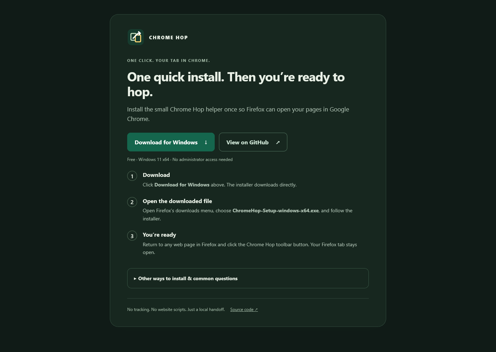

# Toolbar menu and setup — 1.1.0

- **39 Node tests passed.** Immediate single-tab left-click does not request
  optional permission or query other tabs. The toolbar-only menu requests
  optional `tabs` access; denial/revocation does not launch Chrome. Bulk tests
  cover window scope, ordering, unsafe-page skipping, serialization, duplicate
  action suppression, interrupted batches and sanitized counts.
- Mozilla web-ext lint and the security-invariant check passed. There are no
  host permissions, content scripts, history/cookie API or background tab scans.
  Required permissions are `activeTab`, `nativeMessaging`, `menus`; the only
  optional permission is `tabs` for the explicit bulk menu gesture.
- **Actual Firefox Developer Edition 159.0 and installed Chrome on ASUS:** a
  real left-click opened only its web tab; a real toolbar right-click displayed
  the menu and selecting it produced Firefox’s optional-permission prompt.
  No bulk request reached Chrome before approval. The prompt’s actual primary
  control was invoked through chrome DOM in the disposable headless test
  profile because native popup buttons have no interactable WebDriver rectangle.
- The resulting batch reached real Chrome exactly once for each of two harmless
  loopback pages, in order. Another Firefox window was excluded. Original
  Firefox tabs retained their addresses. Internal pages were skipped.
- The setup page’s direct-download/GitHub links, reused help-tab regression,
  and narrow layout passed in actual Firefox. Screenshots were inspected.
  Existing Firefox profiles and the installed native registration were preserved.
- The helper remains byte-identical to 1.0.0; the helper, ZIP and installer each
  reproduce byte for byte. The stable Setup alias matches the versioned installer.

The raw [browser receipt](bulk-1.1.0.json) contains only test paths and status.
The public 1.1.0 release passed Windows CI, installer lifecycle tests, Go tests,
vet/fuzzing, vulnerability checks, reproducibility and provenance verification.
All seven public asset hashes passed. After publication, the actual Firefox
setup button downloaded the exact released Setup executable; see the
[download receipt](download-1.1.0.json). Mozilla's final public/listed submission
completed on October 21, 2026, including reviewer source and saved listing updates.
Version 6602520 is **Awaiting Review**, with **0 errors / 0 warnings**. See the
[Mozilla receipt](amo-1.1.0.json) and [publication status](../publication/STATUS.md).
No additional browser integration tests or software installations were performed
during that submission-only run; the test results above describe the release run.

